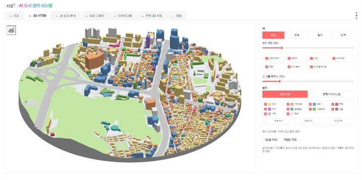

# UrbanAI

> Urban AI : 서초구 AI 도시 관리 시스템<br>
> 서초구의 도시 정보를 3D 모델링으로 시각화하고 AI를 활용해 도시 정보를 분석하여 정책에 반영합니다.

<p align="center">
  
</p>


UrbanAI는 도시계획, 건축 인허가, 재건축·재개발 검토에 필요한 공간정보를
지도·3D·대지분석 도판으로 시각화하고, 자연어 명령으로 도시 현황을 분석하거나
건축물 매스를 시뮬레이션하는 웹 애플리케이션입니다.

분석 대상은 **서울특별시 서초구**이며, 강남구·동작구·관악구 데이터는 주변 맥락을
표현하기 위한 3D 인접 지역으로 사용합니다.

## 주요 기능

- **지도 기반 대지 선택**: 주소 검색, 지도 클릭, 원형·사각 분석 범위 설정
- **3D 시각화**: 건물 매스, 지형, 도로, 녹지 및 인접 자치구 표시
- **AI 도시 분석**: 자연어 기반 필터·브리핑·후보지 검색·높이 변경·침수 가시화·타임랩스
- **일조·그림자 분석**: 날짜·시각별 그림자와 동지 기준 지면 일조시간 시각화
- **20종 분석 다이어그램**: 항공사진, 건축물, 용도, 준공 연대, 높이, 용도지역,
  교통, 지형, 경사도, 필지, 수목 등을 SVG로 생성하고 ZIP으로 내려받기
- **전역 3D 지도**: 서초구 전체 건물과 경계 밖 약 600m의 공간 맥락 제공
- **오프라인 폴백**: API 키가 없어도 내장 fixture와 규칙 기반 자연어 분석으로 핵심 기능 확인
- **월간 데이터 동기화**: VWorld, Copernicus DEM, 서울 열린데이터를 로컬 SQLite에 저장

생성형 AI는 자연어 의도를 구조화하는 역할만 담당합니다. 건물 집계, 높이, 일조, 침수 수면 및 후보지 점수는 서버의 결정적 로직으로 계산합니다.

## 화면 구성

1. `지도`
2. `3D 시각화`
3. `AI 도시 분석`
4. `일조·그림자`
5. `다이어그램`
6. `전역 3D 지도`
7. `정보`

## 기술 스택

- **Frontend**: React 19, TypeScript 6, Vite 8
- **Map / 3D**: Leaflet 1.9, Three.js 0.185
- **Backend**: Python 3.11+, FastAPI, Uvicorn, Pydantic
- **GIS / Image**: Shapely, PyProj, GeoJSON, NumPy, Pillow, tifffile
- **Database**: SQLite
- **AI**: CLOVA Studio OpenAI-compatible Chat Completions
  (`LLM42-Gemma4`, 표시명 Gemma-4-31B-Vision)
- **Test / Quality**: pytest, pytest-asyncio, TypeScript compiler, Oxlint

## 데이터 출처

| 데이터 | 출처 |
| --- | --- |
| 건물·높이·용도·준공일 | 국토교통부 GIS건물통합정보, VWorld 도로명주소 건물 |
| 용도지역·공원녹지·지적 | VWorld, OpenStreetMap |
| 도로·가구·역·정류장 | OpenStreetMap 기여자 |
| 지형·등고선·경사도 | Copernicus DEM GLO-90 또는 GLO-30 |
| 항공사진·수관·수목 | VWorld 항공영상, HSV+ExG 기반 탐지 |
| 가로수 | 서울열린데이터광장 `streetTreeInfo` |
| 일조·그림자 | NOAA 태양 위치 계산, 높이 정보가 있는 건물 footprint |

## 실행 환경

- Windows 10/11 64-bit
- Python 3.11 이상
- Node.js 20.19 이상
- 최신 Chrome 또는 Edge
- 전역 3D 사용 시 메모리 8GB 이상 권장

## 로컬 실행

프로젝트 루트에서 아래 명령을 실행합니다.

### 1. 환경변수 및 의존성 설치

```powershell
Copy-Item .env.example .env

py -3.11 -m venv .venv
.\.venv\Scripts\python -m pip install --upgrade pip
.\.venv\Scripts\python -m pip install -r backend\requirements.txt

Set-Location frontend
npm install
Set-Location ..
```

### 2. 서버 실행

두 개의 PowerShell 터미널을 사용합니다.

```powershell
# 터미널 1: FastAPI
.\scripts\run_api.bat
```

```powershell
# 터미널 2: Vite
.\scripts\run_web.bat
```

브라우저에서 <http://127.0.0.1:5173>에 접속합니다. 같은 네트워크의 다른 PC에서는
`http://<실행-PC의-IPv4>:5173`으로 접속할 수 있습니다.

API 키 없이 시작하면 최초 실행 시 fixture 데이터가 SQLite에 자동 적재됩니다.

## 환경변수

민감정보는 `.env`에만 저장하고 저장소에 커밋하지 않습니다. 전체 설정과 설명은
[`.env.example`](.env.example)을 참고하십시오.

| 변수 | 용도 | 필수 여부 |
| --- | --- | --- |
| `VWORLD_API_KEY` | 실데이터, 주소 검색, VWorld 타일 | 선택 |
| `VWORLD_DOMAIN` | VWorld 인증 도메인 | 선택 |
| `CARTO_API_KEY` | Carto Voyager 단순지도 | 선택 |
| `CDSE_CLIENT_ID` / `CDSE_CLIENT_SECRET` | Copernicus DEM 동기화 | 선택 |
| `CDSE_DEM_INSTANCE` | `COPERNICUS_90` 또는 `COPERNICUS_30` | 선택 |
| `SEOUL_OPEN_API_KEY` | 서울시 가로수 데이터 동기화 | 선택 |
| `CLOVA_API_KEY` | 생성형 자연어 분석 | 선택 |
| `CLOVA_BASE_URL` / `CLOVA_MODEL` | AI 게이트웨이와 모델 설정 | 선택 |
| `ADMIN_TOKEN` | 관리 API 인증 | 관리 기능 사용 시 필수 |
| `DATABASE_PATH` | SQLite 파일 경로 | 선택 |

키가 없거나 AI 호출에 실패하면 지원 가능한 문장에 한해 규칙 기반 분석으로
폴백합니다. `ADMIN_TOKEN`이 비어 있으면 `/api/admin/*` 요청은 거부됩니다.

## 실데이터 동기화

필요한 API 자격 증명을 `.env`에 설정한 후 실행합니다.

```powershell
.\.venv\Scripts\python scripts\sync_monthly.py
```

화면의 `정보` 탭에서도 동기화를 시작할 수 있습니다. 이 경우 `.env`의
`ADMIN_TOKEN`이 `X-Admin-Token` 헤더로 전달되어야 합니다.

## 테스트 및 정적 검사

```powershell
# Backend
.\.venv\Scripts\python -m pytest tests -q

# Frontend
Set-Location frontend
npm run lint
npm run build
```

## Docker 배포

Docker 이미지는 빌드된 Frontend 정적 파일을 포함하므로 먼저 Frontend를 빌드합니다.

```powershell
Set-Location frontend
npm install
npm run build
Set-Location ..

docker compose up --build -d
```

기본 Compose 설정은 애플리케이션을 `127.0.0.1:8090`에 바인딩하고 `data/`를
컨테이너에 마운트합니다. 운영 환경에서는 Reverse Proxy와 TLS를 별도로 구성하십시오.

## API

FastAPI 서버 실행 후 OpenAPI 문서는 <http://127.0.0.1:8000/docs>에서 확인할 수 있습니다.

| Method | 경로 | 설명 |
| --- | --- | --- |
| `GET` | `/api/health` | DB, 데이터 및 API 키 설정 상태 |
| `GET` | `/api/panels` | 20종 패널 메타데이터 |
| `GET` | `/api/panel` | 개별 분석 패널 SVG 생성 |
| `GET` | `/api/mass3d` | 선택 범위의 3D GeoJSON |
| `GET` | `/api/city3d/meta` | 전역 3D 버전·범위·스타일 |
| `GET` | `/api/city3d/buildings` | 서초구 건물 매스 |
| `GET` | `/api/city3d/ground` | 서초구 경계·지형·도로·녹지 |
| `GET` | `/api/city3d/context` | 경계 밖 주변 건물·도로 |
| `POST` | `/api/sim/apply` | 선택 건물 수정 또는 신규 매스 생성 |
| `POST` | `/api/analysis/ask` | 자연어 도시 분석 |
| `POST` | `/api/admin/fixtures` | fixture 재적재 |
| `POST` | `/api/admin/sync` | 실데이터 동기화 시작 |

분석 좌표는 서초구 범위로 제한되며 범위 밖 요청은 `400 Bad Request`로 거부됩니다.

## 프로젝트 구조

```text
sitedia/
├── backend/             # FastAPI API, GIS 처리, 동기화 및 분석 로직
├── frontend/            # React UI, Leaflet 지도, Three.js 3D
├── data/                # SQLite와 동기화 데이터(버전 관리 제외)
├── json/                # 데이터 출처, 용어, 변수, 함수 참조 정보
├── md/                  # 참조 정보 설명 문서
├── scripts/             # 로컬 실행, fixture 적재, 데이터 동기화 도구
├── tests/               # Backend 단위·통합 테스트
├── .env.example         # 환경변수 템플릿
├── docker-compose.yml
└── Dockerfile
```

## 제약 및 주의사항

- 일조시간은 동지 기준 지면 일조 참고도이며 법정 일조권 판정 결과가 아닙니다.
- 경사도는 DEM 기반 참고값이며 조례상 평균경사도 산정값이 아닙니다.
- 침수 화면은 강수량과 지형을 이용한 가시화이며 공식 홍수 예경보가 아닙니다.
- 용도·준공 연도가 없는 건물은 추정하지 않고 `미상`으로 표시합니다.
- 수목 탐지는 항공영상 색상에 기반하므로 계절, 그림자 및 촬영 상태의 영향을 받습니다.
- 완전 폐쇄망에서는 사전 동기화된 DB와 fixture 기반 기능을 사용할 수 있지만,
  생성형 AI 호출과 온라인 타일 갱신은 사용할 수 없습니다.

## 보안

- API 키와 관리 토큰은 서버의 `.env`에서만 읽으며 Frontend에 직접 전달하지 않습니다.
- `.env`, SQLite 실데이터, 인증서 및 운영 배포 설정은 `.gitignore`에서 제외합니다.
- 공개 저장소에 업로드하기 전 `git status`와 커밋 이력을 확인하여 시크릿 포함 여부를
  반드시 점검하십시오.

## 라이선스

[MIT License](LICENSE)

사용, 복제, 수정, 배포가 가능합니다. 수정하거나 배포하는 경우, 또는 이를 바탕으로
추가 작업을 하는 경우 최초 제작자 **서초구청 홍성민 주무관 (irize@seocho.go.kr)** 을
표기해야 합니다. 저작권 고지와 라이선스 문구도 함께 유지합니다.
